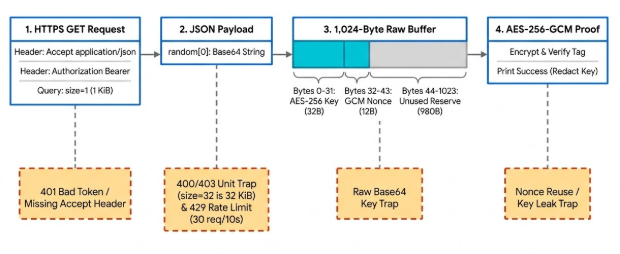
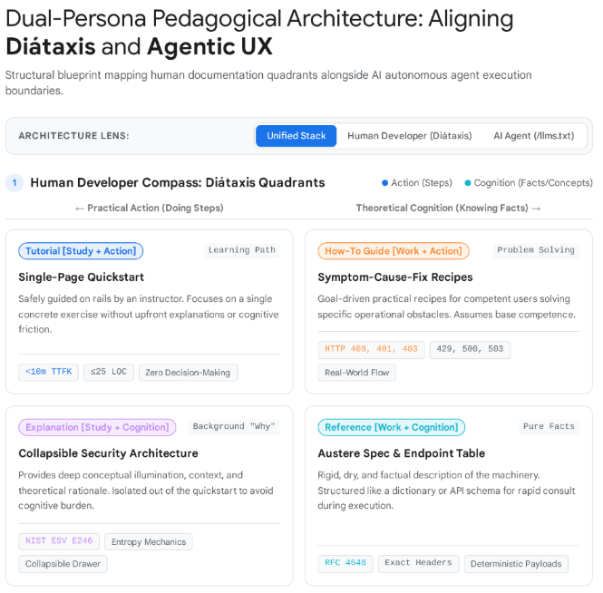
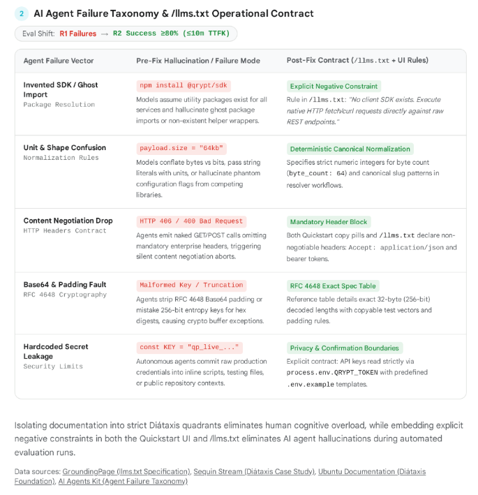
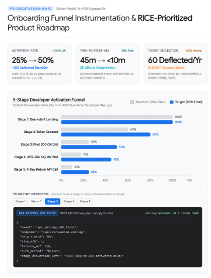
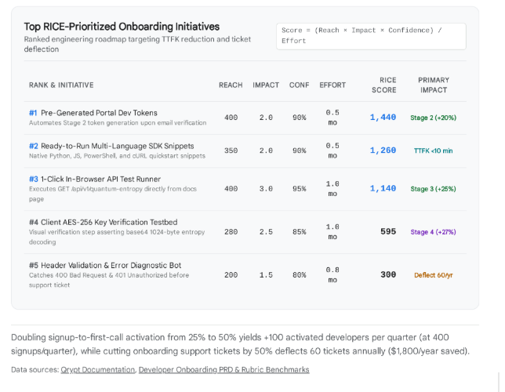

# What these are

The owner gave five screenshots of design mock-ups with the brief on 2026-10-19. An AI research
tool made them alongside [the research blueprint](research-blueprint.md). Every number in them is
a design target or an assumption, not a measurement. The text below was read from the images; a
word that could not be read for sure is marked "(as far as it can be read)". Where an image
disagrees with [the assessment's text](assessment-text.md), the assessment wins, and
[the review](research-review.md) lists each such disagreement.

# 1. The entropy-to-key pipeline and its traps

The path of one quickstart run, in four steps, each with the mistake that breaks it:[^shot-pipeline]

| Step | What it shows | The trap under it |
|---|---|---|
| 1. HTTPS GET Request | `Accept: application/json`, `Authorization: Bearer`, query `size=1` (1 KiB) | 401 Bad Token / Missing Accept Header |
| 2. JSON Payload | `random[0]`: a base64 string | 400/403 Unit Trap (`size=32` is 32 KiB) and 429 Rate Limit (30 req/10s) |
| 3. 1,024-Byte Raw Buffer | Bytes 0–31: AES-256 key (32 B). Bytes 32–43: GCM nonce (12 B). Bytes 44–1023: unused reserve (980 B) | Raw Base64 Key Trap |
| 4. AES-256-GCM Proof | Encrypt and verify the tag; print success, the key redacted | Nonce Reuse / Key Leak Trap |

Use it for: the site's one-picture explanation of the run, and the order of the troubleshooting
page.

# 2. Diátaxis quadrants for the human developer

Titled "Dual-Persona Pedagogical Architecture: Aligning Diátaxis and Agentic UX", with a lens
switcher of three tabs: Unified Stack, Human Developer (Diátaxis), AI Agent (/llms.txt). Section 1,
"Human Developer Compass", runs from practical action (doing steps) to theoretical cognition
(knowing facts):[^shot-diataxis]

| Quadrant | Page it maps to | What it says | Its tags |
|---|---|---|---|
| Tutorial (Study + Action), "Learning Path" | Single-Page Quickstart | Safely guided on rails by an instructor; one concrete exercise, no upfront explanation | `<10m TTFK`, `≤25 LOC`, Zero Decision-Making |
| How-To Guide (Work + Action), "Problem Solving" | Symptom-Cause-Fix Recipes | Goal-driven recipes for competent users solving specific operational obstacles | HTTP 400, 401, 403; 429, 500, 503; Real-World Flow |
| Explanation (Study + Cognition), "Background 'Why'" | Collapsible Security Architecture | Context and rationale, kept out of the quickstart to avoid cognitive burden | NIST ESV E246, Entropy Mechanics, Collapsible Drawer |
| Reference (Work + Cognition), "Pure Facts" | Austere Spec & Endpoint Table | Dry, factual description of the machinery, for a quick look during execution | RFC 4648, Exact Headers, Deterministic Payloads |

Use it for: the site's information architecture, one page or section per quadrant.

# 3. The agent failure taxonomy and the llms.txt contract

Section 2 of the same mock-up, "AI Agent Failure Taxonomy & /llms.txt Operational Contract", with
the target "Eval Shift: R1 Failures → R2 Success ≥80% (≤10m TTFK)":[^shot-taxonomy]

| Agent failure vector | Failure before the fix | Contract after the fix (`/llms.txt` and the page) |
|---|---|---|
| Invented SDK / Ghost Import (package resolution) | `npm install @qrypt/sdk`: models assume a helper package exists | Explicit negative constraint in `/llms.txt`: "No client SDK exists. Execute native HTTP fetch/curl requests directly against raw REST endpoints." |
| Unit & Shape Confusion (normalization rules) | `payload.size = "64kb"`: bytes and bits conflated, units passed as strings | Deterministic canonical normalization: strict numeric integers for the count (`byte_count: 64`) and canonical patterns |
| Content Negotiation Drop (HTTP headers contract) | HTTP 406 / 400 Bad Request: bare GET/POST calls without the mandatory headers | Mandatory header block: the copy buttons and `/llms.txt` both declare `Accept: application/json` and the bearer token |
| Base64 & Padding Fault (RFC 4648) | Malformed key / truncation: padding stripped, or the 256-bit key mistaken for a hex digest | RFC 4648 exact spec table: the 32-byte decoded length, copyable test vectors, padding rules |
| Hardcoded Secret Leakage (security limits) | `const KEY = "qp_live_..."`: credentials committed in scripts, tests or public repositories | Privacy and confirmation boundaries: the key read only from the environment (the image says `process.env.QRYPT_TOKEN`), with a `.env.example` template |

Its closing line: "Isolating documentation into strict Diátaxis quadrants eliminates human
cognitive overload, while embedding explicit negative constraints in both the Quickstart UI and
/llms.txt eliminates AI agent hallucinations during automated evaluation runs." Its data sources:
GroundingPage (llms.txt specification), Sequin Stream (Diátaxis case study), Ubuntu documentation
(Diátaxis foundation), AI Agents Kit (agent failure taxonomy).

Use it for: the starting taxonomy of the agent-readiness test, to be replaced by the failures the
runs actually show.

# 4. The funnel instrumentation dashboard

"PRD Executive Dashboard", cohort model N = 400 signups a quarter, titled "Onboarding Funnel
Instrumentation & RICE-Prioritized Product Roadmap".[^shot-dashboard]

| Tile | Baseline → target | Its note |
|---|---|---|
| Activation rate | 25% → 50% (+100% lift) | +100 activated developers a quarter; goal: 200 of 400 signups get a first successful API 200 OK |
| Time to first key | 45 min → <10 min (−78% time) | 35-minute compression; skips the portal's manual auth friction through a quickstart sandbox |
| Ticket deflection | 60 deflected a year (−50% volume) | $1,800 a year of support saved; removes recurring 401 and header-configuration cases |

The five-stage funnel, cohort conversion from 400 signups a quarter, baseline (25% final) against
target (50% final):

| Stage | Baseline | Target |
|---|---|---|
| 1. Quickstart Landing | 100% | 100% |
| 2. Token Created | 60% | 80% |
| 3. First 200 OK Call | 25% | 50% |
| 4. AES-256 Key Verified | 18% | 45% |
| 5. 7-Day Return API Call | 10% | 25% |

The telemetry inspector shows stage 3's event, `api_entropy_200_first`, from the REST API gateway
(api-eus.qrypt.com, as far as it can be read), joined on `account_id + token_hash`, with the
payload: `event: "api_entropy_200_first"`, `endpoint: "/api/v1/quantum-entropy"`,
`http_status: 200`, `size_kib: 1`, `latency_ms: 118` (as far as it can be read),
`auth_method: "Bearer"`, `stage_conversion_lift: "+25% (100 to 200 activated devs)"`.

Use it for: the PRD's funnel table and the instrumentation spec. The stage targets of stages 2, 4
and 5 are the mock-up's own assumptions; the brief sets only stage 3's.

# 5. The RICE-prioritized onboarding initiatives

"Top RICE-Prioritized Onboarding Initiatives: ranked engineering roadmap targeting TTFK reduction
and ticket deflection", scored as (Reach × Impact × Confidence) / Effort, effort in
months:[^shot-roadmap]

| Rank | Initiative | Reach | Impact | Conf. | Effort | RICE | Primary impact |
|---|---|---|---|---|---|---|---|
| 1 | Pre-Generated Portal Dev Tokens: makes the stage 2 token on email verification | 400 | 2.0 | 90% | 0.5 mo | 1,440 | Stage 2 (+20%) |
| 2 | Ready-to-Run Multi-Language SDK Snippets: native Python, JS, PowerShell and cURL | 350 | 2.0 | 90% | 0.5 mo | 1,260 | TTFK <10 min |
| 3 | 1-Click In-Browser API Test Runner: runs `GET /api/v1/quantum-entropy` from the docs page | 400 | 3.0 | 95% | 1.0 mo | 1,140 | Stage 3 (+25%) |
| 4 | Client AES-256 Key Verification Testbed: shows the base64 1,024-byte entropy decoding | 280 | 2.5 | 85% | 1.0 mo | 595 | Stage 4 (+27%) |
| 5 | Header Validation & Error Diagnostic Bot: catches 400 and 401 before a support ticket | 200 | 1.5 | 80% | 0.8 mo | 300 | Deflect 60/yr |

Its closing line: "Doubling signup-to-first-call activation from 25% to 50% yields +100 activated
developers per quarter (at 400 signups/quarter), while cutting onboarding support tickets by 50%
deflects 60 tickets annually ($1,800/year saved)." Its data sources: Qrypt documentation, the
developer onboarding PRD and rubric benchmarks. Each RICE score is the product of its row, as
the formula says.

Use it for: the shape of `BACKLOG.md`. The brief wants ten items drawn from the agent-readiness
findings, so these five are candidates until the runs give their evidence.

[^shot-pipeline]: Screenshot 1, the entropy-to-key pipeline and its traps
[^shot-diataxis]: Screenshot 2, Diátaxis quadrants for the human developer
[^shot-taxonomy]: Screenshot 3, the agent failure taxonomy and the llms.txt contract
[^shot-dashboard]: Screenshot 4, the funnel instrumentation dashboard
[^shot-roadmap]: Screenshot 5, the RICE-prioritized onboarding initiatives
